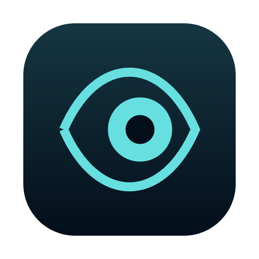
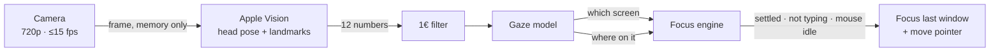

<!-- prettier-ignore -->
<div align="center">



# Turnkey

*Turn your head. Your keys follow.*

[](#privacy)
[](#privacy)
<br>
[](https://www.swift.org)
[](https://www.apple.com/macos/)
[](https://developer.apple.com/xcode/swiftui/)
[](https://developer.apple.com/documentation/vision)
[](https://www.swift.org/documentation/package-manager/)

[Features](#features) • [How it works](#how-it-works) • [Install](#install) • [Usage](#usage) • [Privacy](#privacy) • [Settings](#settings) • [Development](#development)

</div>

Turnkey is a menu bar app for Macs with more than one screen. You **turn** toward a screen and your **keys** are already there: it reads which way your head is pointing through the camera and makes that screen's window the one you type into — before your first keystroke, without touching the mouse. All of it happens on-device: frames are analysed in memory by Apple's Vision framework and discarded, and the app contains no networking code at all.

## Features

- **Focus follows your head** — face the MacBook or the monitor and, after a 300 ms settle, the window you last used there takes your keystrokes.
- **The pointer moves with you** — so new windows, Spaces and Mission Control open on the screen you're facing.
- **Never cuts into your typing** — focus only moves between bursts of keys; keep typing while reading the other screen and it waits for you to pause.
- **Still while you mouse** — nothing moves while you use the mouse or trackpad, or for 1.5 s after.
- **Steady at the bezel** — crossing back over an edge takes a slightly bigger turn, and looking at your phone, the desk or the ceiling doesn't count.
- **Sharpens with use** — clicks on the screen you're facing refine the model, and a notification tells you when it's time to recalibrate.
- **Lean in, sit back** — changes in distance are compensated automatically.
- **One shortcut to pause** — <kbd>⌃</kbd><kbd>⌥</kbd><kbd>⌘</kbd><kbd>G</kbd>, or the eye in the menu bar. The camera also stops when the screen locks or the Mac sleeps.
- **Optional finer focus** — the window or split pane you look at on the same screen (iTerm2, Terminal, Ghostty, Xcode, VS Code, Cursor…). Off by default.

## How it works



1. **Measure** — Vision finds your face, head yaw and pitch, eye contours, pupils and nose. These are boiled down to 12 numbers — head turn, nose and jaw asymmetry, pupil position against the eye corners, eyelid opening, head position and distance — and the frame is released.
2. **Classify** — a short calibration (follow a dot, about 30 s per screen, with extra stops along the edge two screens share) trains two small models: a classifier for *which* screen you face and a per-screen regression for *where* on it. Stops where you clearly weren't looking at the dot are thrown out.
3. **Hand over** — once you've settled on a screen, aren't typing or using the mouse, and are clearly past the edge, Turnkey makes that screen's last-used window key — without clicking it, so the split pane inside keeps its focus — and brings the pointer along.

## Install

Requirements: macOS 14 or later, Xcode 15+ (Swift 5.9+), a camera.

```bash
git clone https://github.com/baraaxalrefai/turnkey.git
cd turnkey
./build.sh --install   # tests, release build, offline check, sign, copy to ~/Applications, launch
```

The setup window walks you through the first run:

1. **Allow the camera** — so Turnkey can measure which way you're facing.
2. **Allow Accessibility** — so it can bring windows forward and move the pointer (System Settings → Privacy & Security → Accessibility → Turnkey).
3. **Calibrate** — press <kbd>Space</kbd>, follow the dot, press <kbd>Return</kbd>.

> [!TIP]
> Calibrate sitting the way you usually do, and let your head turn naturally toward each dot: screen switching runs on head turn, not eye flicks. Recalibrate after moving the laptop or a monitor.

## Usage

The eye in the menu bar shows what Turnkey sees — `Facing: DELL P2725H`, `Facing: away from the screens` — or why it's holding back, e.g. `waiting, you're typing`.

| | |
|---|---|
| <kbd>⌃</kbd><kbd>⌥</kbd><kbd>⌘</kbd><kbd>G</kbd> | Pause / resume (the camera turns off while paused) |
| **Calibrate Screens…** | Recalibrate every screen, or one at a time from Settings → Screens |
| **Show Gaze Dot** | Draws where Turnkey thinks you're looking, with its uncertainty |
| **Settings…** | Timing, edges, camera, learning, privacy counters, diagnostics |

## Privacy

> [!IMPORTANT]
> Camera frames never leave memory. Nothing is recorded, written to disk or sent anywhere.

- Frames are analysed in place by Apple's Vision framework, on-device, and released as soon as the callback returns.
- 720p at no more than 15 frames a second: 10 in screens-only mode, 4 when nobody is in front of the camera.
- **No networking code.** `build.sh` refuses to build if a networking API appears in the sources, and fails if the binary links a networking framework.
- Apart from its settings, the only file it writes is `~/Library/Application Support/Turnkey/calibration.json` (mode 600): head-pose numbers from calibration and learned clicks, no images. Delete it from Settings → Screens.
- Center Stage is switched off for the app, so the picture is never re-framed.

## Settings

| Setting | Default | What it does |
|---|---|---|
| Settle on a screen for | 300 ms | How long you must face another screen before focus moves |
| Reading while typing | 1.5 s | Keep typing while looking at another screen and focus waits this long after your last key |
| Mouse / trackpad wait | 1.5 s | No switching while you use the mouse, and for this long after |
| Edge stickiness | 2.0 | How much farther you must turn to cross back over an edge |
| Still counts as a screen | 25% outside it | Anything farther out (phone, desk, window) counts as looking away |
| Move the pointer | On | Bring the pointer to the screen you turn to |
| Same-screen windows / split panes | Off | Finer-grained focus within one screen |
| Learn from my clicks | On | Refine the model from clicks on the screen you're facing |
| Start at login | On | Launch with your Mac |

## Development

```bash
swift test               # model tests on a simulated desk (MacBook + angled 27" monitor)
./build.sh               # build "build/Turnkey.app"
./build.sh --install     # …then install to ~/Applications and relaunch
log stream --predicate 'subsystem == "io.github.baraaxalrefai.turnkey"'   # watch decisions live
```

```
Sources/
├── TurnkeyCore/    pure maths: features, 1€ filter, ridge + softmax, trainer, calibration layout
└── Turnkey/
    ├── Camera/     AVFoundation capture, Vision face tracking
    ├── Tracking/   smoothing pipeline, model store, click learning, drift detection
    ├── Engine/     the focus engine: dwell, typing and mouse rules, hysteresis
    ├── System/     displays, Accessibility, window focusing, panes, hotkey, sleep and lock
    └── UI/         menu bar, calibration, gaze dot, settings, setup guide
```

> [!NOTE]
> The app is signed ad-hoc with a fixed designated requirement (`identifier "io.github.baraaxalrefai.turnkey"`), so Camera and Accessibility permissions survive rebuilds. Making a window key without clicking uses the same private SkyLight calls as AltTab and yabai, with a public Accessibility fallback.

## Troubleshooting

- **It doesn't switch** — the menu shows why (`waiting, you're typing` / `…using the mouse`). Turn on *Show Gaze Dot*, or recalibrate.
- **It switches too eagerly at the edge** — raise *Edge stickiness* or *Settle on a screen for*, or nudge *Edge bias* per screen in Settings → Screens.
- **"Turnkey keeps missing" notification** — a monitor or your chair moved; recalibrate.
- **Permissions look on but nothing happens** — remove Turnkey from Privacy & Security → Accessibility and add it again.

<sub>Smoothing uses the [1€ filter](https://gery.casiez.net/1euro/) by Casiez, Roussel and Vogel.</sub>
